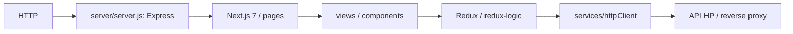

# Helpdesk Web — dokumentacja techniczna

Stan lokalnego kodu: **31.10.2026**. [Referencja frontendu](frontend-reference.md) zawiera skrypty npm, zależności, strony, jawne przepisania Express i wykaz testów. [Praca lokalna](development.md) opisuje polecenia i diagnostykę.

## Architektura wykonania



Proces uruchamia własny serwer Node, a nie samo standardowe `next start`. `NODE_ENV` wybiera tryb Next.js; serwer rejestruje nagłówki, opcjonalne proxy developerskie i trasy z `server/routes.js`, a na końcu catch-all Next.js.

Pliki `pages` są wejściami routingu. Widoki są w `views`, komponenty współdzielone w `components`. `pages/_app.jsx` inicjalizuje Provider Redux, JSS/Material-UI i obsługę przejść Routera. To projekt ze starszym Pages Routerem; dokumentacja nie zakłada App Routera ani API nowych wersji Next.js.

## Stan, HTTP i autoryzacja

[services/redux/store.js](../services/redux/store.js) buduje store z reducerów i middleware `redux-logic`, odtwarza utrwalany stan, tworzy klienta Axios i przekazuje go jako zależność logiki. [services/redux/logic.js](../services/redux/logic.js) składa lokalne moduły i logikę importowaną z `@hello-poland/commons`.

[httpClient.js](../services/httpClient/httpClient.js) tworzy instancję Axios, nakłada konfigurację publiczną i rejestruje interceptory. [requestInterceptors.js](../services/httpClient/requestInterceptors.js) pobiera credentials ze stanu profilu. Obsługę błędów i odświeżenia należy sprawdzać także w `responseInterceptors.js` oraz pakiecie `@fream/axios-commons`.

Kod z pakietu commons jest zależnością, nie lokalnym plikiem `redux`. Przy analizie przepływu trzeba sprawdzić wersję z lockfile i implementację dostępnej zależności. Sama nazwa importu nie dowodzi konkretnego URL lub payloadu.

## Konfiguracja procesu i bundla

| Element | Rzeczywiste źródło |
| --- | --- |
| Plik konfiguracji | `CONFIG_PATH` lub `./config/develop.config.js` w `next.config.js` |
| Konfiguracja serwera | `config.server` → `serverRuntimeConfig` |
| Konfiguracja klienta | `config.public` → `publicRuntimeConfig`; dostępna przeglądarce |
| Host | `server.host`, potem `NODE_HOST`, potem `127.0.0.1` |
| Port | `NODE_PORT`, domyślnie 3000 |
| Tryb produkcyjny | `NODE_ENV=production` |
| Proxy w kodzie Node | Montowane wyłącznie poza production; `/api` → `server.apiURL`, z usunięciem prefiksu |

`CONFIG_PATH` powinien być bezwzględny, ponieważ konfigurację ładują moduły z różnych katalogów. Plik jest odczytywany przez `require`; podmiana go nie odświeża działającego procesu. Konfigurację trzeba uwzględnić przy buildzie i starcie, a wynikowy adres API sprawdzić w przeglądarce.

Sekcja `public` nie jest miejscem na sekrety. Produkcyjny routing `/api` wymaga reverse proxy lub bezpośredniego URL skonfigurowanego w kliencie; nie zapewnia go middleware development.

## Narzędzia i artefakty

Manifest deklaruje React 16, Next 7 i Material-UI 3; pełny wykaz znajduje się w referencji. `engines` wskazuje Node `^10`, a `Dockerfile.release` domyślnie Node 14. Te deklaracje nie są uzgodnionym, aktualnie przetestowanym środowiskiem — przy odtwarzaniu buildu trzeba ustalić właściwy wariant.

Build Next.js zapisuje `.next`. Uruchomienie produkcyjne wymaga pasującego kodu, zależności i bundla; samo udane uruchomienie Node nie potwierdza świeżości UI. W projekcie są różne Dockerfile, więc tag obrazu i sposób przygotowania źródeł należy ustalić dla konkretnego procesu wydania.

`jsdoc.json` i skrypty `jsdoc` / `jsdoc2md` dotyczą referencji komentarzy JS. Nie zastępują opisu architektury ani kontraktu backendu. Nie uruchamiano ich w tej pracy.

## Testy i sposób zmiany

Jest korzysta z `jest.config.js` i `jest.setup.js`; Babel konfiguruje transformację kodu. Z katalogu modułu, z przygotowanymi zależnościami:

```sh
npm test -- --runInBand
npm run lint
npm run build
```

Dobieramy testy do zmienionego modułu i sprawdzamy, czy przypadek dotyczy komponentu, Redux, kontraktu HTTP czy rzeczywistego środowiska przeglądarki. Atrapa `httpClient` nie weryfikuje autoryzacji backendu, sesji serwera ani trasy proxy.

Przed zmianą współdzielonego formularza sprawdzamy wszystkie jego wywołania. Przy zmianie API kontrolujemy serializację, nazwy ID i format błędu. W tej pracy wykonano przegląd kodu i inwentaryzację; nie instalowano zależności ani nie uruchamiano aplikacji i testów panelu.
